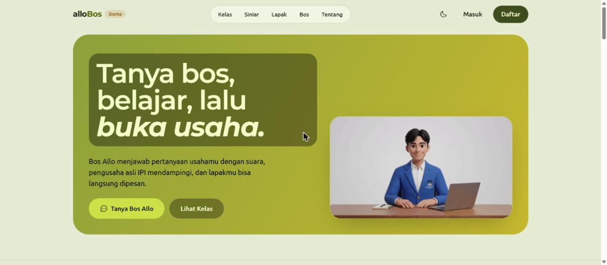
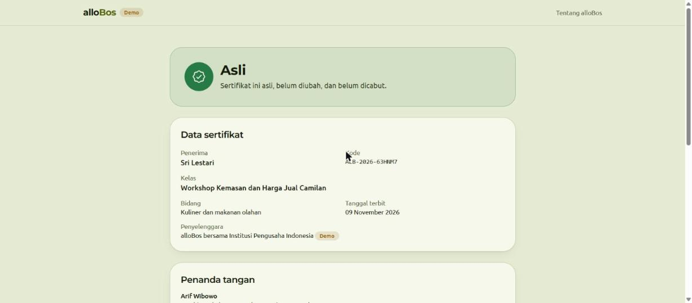
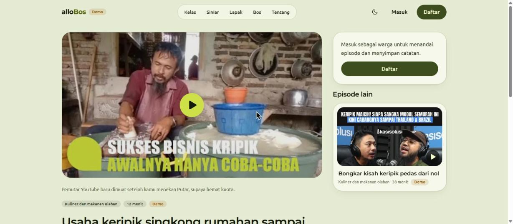

# alloBos

Pendamping usaha berbasis AI untuk warga Gunungkidul, dari bertanya sampai membuka lapak.

IT RUSH 2026, Web Development, Subtema 3 Ekonomi dan Pemberdayaan Masyarakat. Mitra pelaksana: Institusi Pengusaha Indonesia (IPI), Gunungkidul.

Versi berjalan: https://allobos.zite.my.id



## Ringkasan

Warga bertanya kepada **Bos Allo**, bos virtual berbasis AI yang bisa diajak bicara dengan suara. Bila perlu, warga memesan sesi dengan bos asli: pengusaha aktif yang dikurasi IPI. Di belakangnya ada kelas pelatihan dengan Sertifikat Terverifikasi di blockchain, siniar, simulasi warung 3D, pemeriksaan foto produk, penemu peluang, rencana usaha, dan lapak online. Semua aktivitas tercatat sebagai Jejak Usaha dan dihitung menjadi Skor Siap Usaha.

## Masalah dan solusi

| Masalah di Gunungkidul | Jawaban alloBos |
| --- | --- |
| Rata-rata lama sekolah 7,64 tahun (BPS 2025), materi bisnis penuh teks sulit dipakai | Bos Allo menjawab dengan suara dan bahasa sehari-hari |
| Pelaku UMKM banyak, pendamping sedikit, pelatihan datang sekali lalu selesai | Pendampingan harian lewat Bos Allo, Langkah 30 Hari, dan Temu Bos |
| Pemasaran konvensional dan harga jual tidak dihitung dari biaya | Kalkulator HPP, Cek Produk, dan Lapak dengan pesan WhatsApp |
| Akses internet tidak merata | Halaman lapak dan verifikasi tanpa skrip berat, video dimuat setelah diminta, Mode Ringan untuk Warung 3D |
| Sertifikat pelatihan kertas mudah dipalsukan | Sertifikat ditandatangani pembicara, sidik digitalnya dicatat di kontrak pintar |

Rincian ada di `docs/KONSEP.md`, `docs/SPESIFIKASI.md`, `docs/ALUR_BISNIS.md`, dan `docs/DESAIN_SISTEM.md`.

## Fitur dan status

Status: **Jalan** = berfungsi dan teruji. **Jalan, cadangan** = teruji dengan jalur cadangan tanpa AI karena kunci Gemini belum tersedia saat pengembangan.

| Modul | Isi | Status |
| --- | --- | --- |
| Profil Usaha | Onboarding lima langkah, modul terkunci sampai selesai | Jalan |
| Ruang Bos | Bos Allo dua GIF, pengenalan dan sintesis suara `id-ID`, mode teks, kuota, Catatan Konsultasi PDF | Jalan, cadangan. Percakapan AI teruji dengan Gemini dipalsukan |
| Temu Bos | Slot, pengajuan, persetujuan, tautan rapat, catatan Bos, penilaian, pengingat, kedaluwarsa 48 jam | Jalan |
| Kelas Bos | Kelas publik, pendaftaran, kuota, kode kehadiran, progres, XLSX peserta | Jalan |
| Sertifikat Terverifikasi | Spesimen tanda tangan, tanda tangan dengan kata sandi, PDF ber-QR, pencatatan ke kontrak, verifikasi publik, pencabutan, catat ulang, tanda tangan dompet opsional | Jalan di jaringan Hardhat lokal. Polygon Amoy belum di-deploy |
| Siniar Bos | Episode dari URL YouTube, ringkasan AI, pemutar hemat data, tanda dengar dan catatan | Jalan, cadangan |
| Warung Bos 3D | Tujuh babak bercerita, orang pertama (papan ketik dan tetikus, gamepad, sentuh), tujuh stasiun di dalam warung, pembeli antre di kasir, perhitungan di server, kejadian AI dengan bank 34 kejadian, Mode Ringan, rapor | Jalan, cadangan |
| Cek Produk | Unggah foto, kompres WEBP, AI penglihatan, Sinyal Pasar, deskripsi siap pakai | Jalan, cadangan. AI teruji dengan Gemini dipalsukan |
| Peluang dan Rencana | Tiga peluang, rencana satu halaman yang bisa diubah, PDF, Kalkulator HPP dan titik impas, Langkah 30 Hari | Jalan, cadangan |
| Lapak | Katalog, produk, stok, moderasi, halaman publik, pesan WhatsApp, laporan, hitungan kunjungan | Jalan |
| Jejak Usaha | Skor Siap Usaha dari bukti, langkah berikutnya, grafik, riwayat lintas modul, notifikasi | Jalan |
| Dashboard Bos, Pengelola, Admin | Kurasi Bos, undangan bertanda tangan, pengumuman, wawasan, pengaturan AI dan prompt berversi, bank kejadian, bobot skor, blockchain, audit, CMS | Jalan |





## Akun demo

Sandi keempat akun sama dengan nilai `DEMO_PASSWORD` di `.env` (bawaan `password123`).

| Peran | Email | Isi |
| --- | --- | --- |
| Warga | warga@allobos.com | Bu Sri, keripik singkong Ponjong. Skor Siap Usaha naik dari 10 sampai di atas 80, punya lapak terbit dan sertifikat tercatat |
| Bos | bos@allobos.com | Pak Arif, Bos aktif dengan slot, sesi selesai, dan penanda tangan kelas |
| Pengelola IPI | pengelola@allobos.com | Mbak Rani, kelas, siniar, moderasi, sertifikat |
| Admin | admin@allobos.com | Pengguna, AI, blockchain, audit |

Semua data contoh berlabel **Demo** dan tidak dihitung di statistik beranda. Isi ulang data demo dengan satu perintah:

```bash
php artisan allobos:demo --force
```

## Menjalankan dengan Docker

Butuh Docker dan Docker Compose.

```bash
cp .env.example .env
# Isi APP_KEY (php artisan key:generate --show, atau string base64 32 byte acak),
# DB_PASSWORD, DB_ROOT_PASSWORD, DEMO_PASSWORD, dan CERT_HASH_SALT.
docker compose up -d --build
```

Aplikasi terbuka di `http://localhost:8080` (ubah lewat `APP_PORT`). Empat layanan berjalan: `app` (Apache dan PHP 8.4, menjalankan migrasi dan data acuan otomatis), `mysql` (8.4), `queue` (antrean AI, PDF, dan pencatatan blockchain), `scheduler` (pengingat, kedaluwarsa sesi, pembersihan transkrip). Bila `SEED_DEMO=true`, data demo diisi otomatis saat basis data masih kosong.

Deploy ke VPS memakai `.github/workflows/deploy.yml`: setelah tes di cabang `main` lulus, GitHub Actions masuk lewat SSH lalu menjalankan `git pull` dan `docker compose up -d --build`. Isi secret `VPS_HOST`, `VPS_USER`, `VPS_SSH_KEY`, `VPS_KNOWN_HOSTS` (hasil `ssh-keyscan` server), `VPS_PATH`, dan bila perlu `VPS_PORT`.

## Deploy ke VPS

Server memakai Docker dan nginx yang sudah ada. Aplikasi hanya mendengar di `127.0.0.1:3040`, nginx menangani HTTPS.

```bash
# dari komputer pengembang (repositori privat, jadi server tidak menarik dari GitHub)
git archive --format=tar HEAD | ssh server "mkdir -p ~/allobos && tar -x -C ~/allobos"
# sekali saja: salin .env produksi (APP_URL https, APP_BIND=127.0.0.1, APP_PORT=3040, kunci Gemini, Resend)
ssh server "cd ~/allobos && docker compose up -d --build"
```

Situs nginx `allobos` meneruskan `allobos.zite.my.id` ke port 3040 dengan sertifikat Let's Encrypt (certbot webroot). Jalankan `sudo nginx -t` sebelum `systemctl reload nginx`.

## Menjalankan lokal tanpa Docker

Butuh PHP 8.2 ke atas (ekstensi gd dengan webp, intl, zip, pdo_mysql, bcmath), Composer, Node 22, dan MySQL 8.

```bash
composer install
npm install
npm --prefix web3 install
cp .env.example .env
php artisan key:generate
# atur DB_* lalu
php artisan allobos:demo --force
npm run build
php artisan serve
php artisan queue:work      # terminal lain
php artisan schedule:work   # terminal lain
```

Untuk sertifikat di jaringan lokal:

```bash
cd web3
npx hardhat node                                  # terminal lain, biarkan berjalan
npx hardhat run scripts/deploy.cjs --network localhost
```

Lalu isi `.env`: `CHAIN_NAME="Hardhat Lokal"`, `CHAIN_ID=31337`, `CHAIN_RPC_URL=http://127.0.0.1:8545`, `CERT_CONTRACT_ADDRESS` dari keluaran deploy, dan `ISSUER_PRIVATE_KEY` dengan kunci akun #0 yang dicetak `hardhat node` (kunci uji publik, hanya untuk lokal).

## Tes

```bash
php artisan test          # 75 tes fitur dan unit, panggilan AI memakai Http::fake, blockchain memakai FakeChainClient
./vendor/bin/pint --test
cd web3 && npm test       # 6 tes kontrak Hardhat
```

Langkah uji manual per peran dan hasilnya ada di `docs/UJI_MANUAL.md`. Catatan keputusan dan sisa pekerjaan ada di `docs/PROGRESS.md`.

## Variabel lingkungan

| Nama | Isi |
| --- | --- |
| `APP_KEY`, `APP_URL`, `APP_PORT`, `APP_BIND` | Kunci aplikasi, alamat publik, port Docker, alamat ikat port (`127.0.0.1` di belakang nginx) |
| `APP_DEMO`, `SEED_DEMO`, `DEMO_PASSWORD` | Lencana Demo, isi data demo otomatis, sandi akun demo |
| `REQUIRE_EMAIL_VERIFICATION` | `false` bila server belum punya SMTP |
| `DB_*`, `DB_ROOT_PASSWORD` | Basis data MySQL |
| `MAIL_*` | Pengiriman email notifikasi. Contoh Resend ada di `.env.example` |
| `GEMINI_API_KEY` | Satu atau beberapa kunci dipisah koma, dipakai bergiliran |
| `GEMINI_MODEL` | Model bawaan semua fitur AI (`gemini-3.1-flash-lite`), bisa ditimpa per fitur di halaman Admin |
| `GEMINI_FALLBACK_MODELS` | Model cadangan dipisah koma, dicoba bila model utama hilang atau galat |
| `BOSS_SESSIONS_PER_DAY` | Batas sesi Ruang Bos per warga per hari |
| `CHAIN_NAME`, `CHAIN_ID`, `CHAIN_TESTNET` | Nama dan id jaringan, tanda jaringan uji |
| `CHAIN_RPC_URL`, `CHAIN_EXPLORER_URL` | RPC dan penjelajah blok |
| `CERT_CONTRACT_ADDRESS` | Alamat kontrak `AlloBosCertificate` |
| `ISSUER_PRIVATE_KEY` | Kunci privat dompet penerbit. Hanya di server |
| `CERT_HASH_SALT` | Garam sidik nama penerima. Jangan diganti setelah ada sertifikat |
| `CHAIN_MIN_BALANCE` | Ambang peringatan saldo dompet penerbit |

## Kontrak pintar

| Jaringan | Alamat | Keterangan |
| --- | --- | --- |
| Hardhat lokal (31337) | `0x5FbDB2315678afecb367f032d93F642f64180aa3` | Alamat deterministik deploy pertama di `hardhat node`. Dipakai selama pengembangan |
| Polygon Amoy (80002) | Belum di-deploy | Menunggu dompet penerbit dan saldo POL uji |

Kode sumber: `web3/contracts/AlloBosCertificate.sol`. Fungsi `issueBatch(bytes32[] hashes, bytes32 classId)`, `revoke(bytes32 hash, string reason)`, `verify(bytes32 hash)`, `setIssuer`, `transferOwnership`. Hanya sidik digital SHA-256 dan id kelas tersamarkan yang ditulis ke blockchain. Nama, nomor, dan email tidak pernah ditulis.

Deploy ke Amoy: isi `CHAIN_RPC_URL` dan `ISSUER_PRIVATE_KEY` di `web3/.env` atau lingkungan, lalu `cd web3 && npm run deploy:amoy`. Alamat tercatat di `web3/deployments/amoy.json`.

## Arsitektur singkat

Laravel 12 monolit dengan Blade, Livewire 3, Alpine, Tailwind 3, Vite. Controller tipis, aturan bisnis di `app/Services/<Domain>`, status di enum `app/Enums`, akses data per pemilik lewat policy. Semua panggilan Gemini lewat `App\Services\Ai\GeminiClient` (JSON berskema, kuota harian, log, penyamaran data pribadi, prompt berversi, kunci bergiliran). Semua akses blockchain lewat `App\Services\Chain\ChainClient` yang memanggil skrip ethers.js di `web3/scripts`. Pola mengikuti proyek PNC Elevate milik penyusun sebagai rujukan, ditulis ulang untuk alloBos.

## Pustaka dan aset

| Nama | Lisensi |
| --- | --- |
| Laravel, Laravel Breeze, Livewire, Alpine.js | MIT |
| Tailwind CSS, @tailwindcss/forms, Vite | MIT |
| spatie/laravel-permission | MIT |
| barryvdh/laravel-dompdf | MIT, dompdf LGPL-2.1 |
| phpoffice/phpspreadsheet | MIT |
| endroid/qr-code | MIT |
| codeat3/blade-phosphor-icons, Phosphor Icons | MIT |
| Chart.js | MIT |
| Three.js | MIT |
| ethers.js, Hardhat | MIT |
| Montserrat (fontsource) | SIL Open Font License 1.1 |
| Ubuntu Font (fontsource) | Ubuntu Font Licence 1.0 |

| Aset | Sumber |
| --- | --- |
| GIF Bos Allo (diam dan bicara) | Disediakan pemilik proyek. `allo-transparan.webp` dibuat dari bingkai pertama GIF diam |
| Adegan Warung Bos 3D | Dibangun dari geometri di kode (`resources/js/warung/`), tanpa model atau tekstur luar |
| Gambar produk dan sampul lapak demo | Dibuat otomatis dengan GD oleh `DemoSeeder` |
| Video episode siniar demo | Video publik YouTube dari kanal kasisolusi dan Pojok Umkm, diputar lewat pemutar YouTube. Hak cipta milik pemilik kanal. Ringkasan disusun dari keterangan video dan berlabel Demo |
| Arah visual | Referensi Dribbble "Creative agency web ui design" oleh Roohi Koohi, diamati untuk palet, bentuk, dan gerak. Tidak ada gambar atau logo referensi yang dipakai |

## Penggunaan AI coding assistant

Sesuai ketentuan lomba butir V.5:

- **Claude Code** (Anthropic), dengan model Claude, dipakai untuk menulis kode aplikasi, tes, kontrak pintar, konfigurasi Docker dan GitHub Actions, serta dokumen `docs/DESAIN.md`, `docs/PROGRESS.md`, `docs/UJI_MANUAL.md`, dan README ini, berdasarkan Konsep Ide, PRD, Business Flow, dan Design System yang disusun pemilik proyek.
- Skill **design-taste-frontend** di Claude Code dipakai sebagai pedoman pekerjaan antarmuka.
- Pemilik proyek menetapkan konsep, spesifikasi, referensi visual, aset Bos Allo, dan aturan kerja di `CLAUDE.md`, lalu memeriksa hasilnya.
- Di dalam aplikasi, fitur AI untuk pengguna memakai Google Gemini lewat `GeminiClient`.

## Lisensi

Kode alloBos dibuat untuk IT RUSH 2026. Nama dan logo IPI dipakai dengan izin tertulis yang masih perlu dikonfirmasi (lihat `docs/KONSEP.md` bagian 11).
